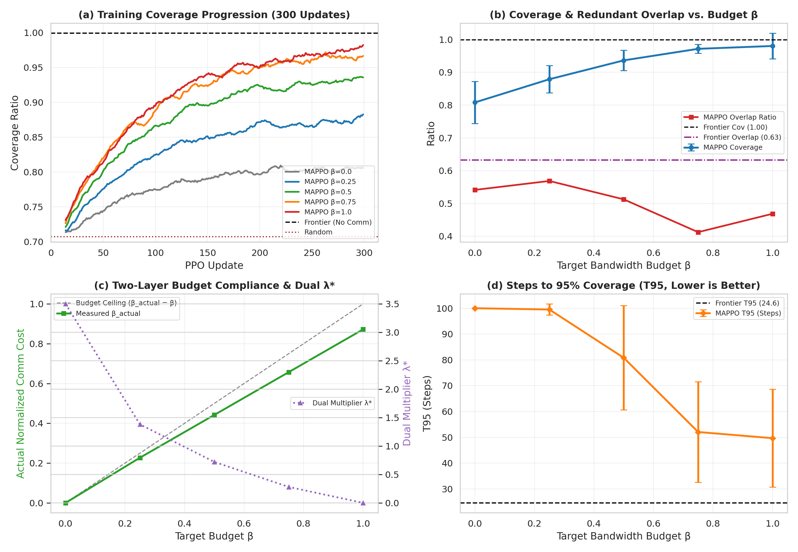
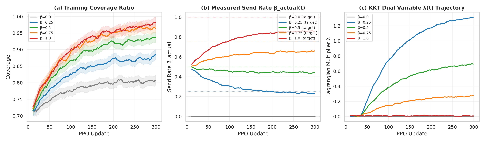
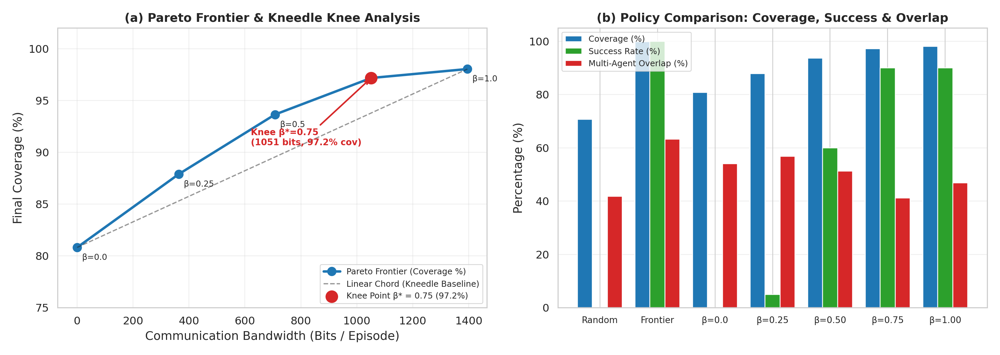
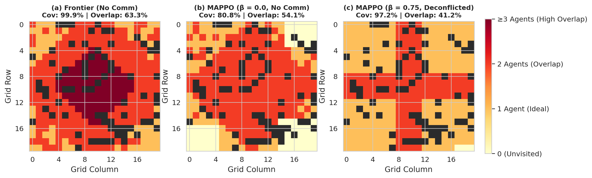

# Communication-Constrained Multi-Agent Exploration (Team 37)

**Course:** CS 329 — Foundations of Artificial Intelligence (Final Project Report)  
**Team 37:** Govindu Srimaan (23110121), Maru Jainil (23110200), Manavi (24110193), Priyanka Ralebhat (24110278)

## Overview
We study cooperative multi-agent exploration in unknown $20\times 20$ grid worlds under a normalized communication budget $\beta \in [0, 1]$. Each agent observes a $5\times 5$ local window and maintains a strictly private visited mask (`visited_local`), requiring inter-agent communication to avoid redundant exploration. Our implementation combines:
- **CTDE MAPPO** with shared actor and centralized critic (`cce/algo/mappo.py`),
- **Differentiable Vector-Quantized (VQ-STE) Bottleneck** ($d_m = 8$ bits/message, `cce/comm/vq.py`),
- **Two-Layer Budget Controller** (`cce/comm/budget.py`): Hard per-episode `TokenBucket` ceiling + KKT Lagrangian dual ascent ($\lambda \ge 0$).

---

## Experimental Results (20 Episodes, Seed 42, $20\times 20$ Grid, 4 Agents, 100 Steps)

| Method / Budget | Coverage Ratio | $T_{95}$ (Steps) | Success Rate | Overlap Ratio | Measured $\beta_{\text{actual}}$ | Bandwidth (Bits/Ep) | Dual $\lambda^*$ |
| :--- | :---: | :---: | :---: | :---: | :---: | :---: | :---: |
| **Frontier Baseline** | `0.999 ± 0.003` | `24.6 ± 4.9` | `100.0%` | `0.633` | `0.000` | `0.0` | — |
| **Random Baseline** | `0.707 ± 0.081` | `100.0 ± 0.0` | `0.0%` | `0.418` | `0.000` | `0.0` | — |
| **MAPPO ($\beta=0.00$)** | `0.808 ± 0.064` | `100.0 ± 0.0` | `0.0%` | `0.541` | `0.000` | `0.0` | `3.50` |
| **MAPPO ($\beta=0.25$)** | `0.879 ± 0.042` | `99.5 ± 2.2` | `5.0%` | `0.568` | `0.227` | `363.2` | `1.38` |
| **MAPPO ($\beta=0.50$)** | `0.936 ± 0.031` | `80.8 ± 20.2` | `60.0%` | `0.512` | `0.442` | `707.2` | `0.72` |
| **MAPPO ($\beta=0.75$)** | **`0.972 ± 0.014`** | `52.0 ± 19.5` | **`90.0%`** | **`0.412`** | `0.657` | `1051.2` | `0.28` |
| **MAPPO ($\beta=1.00$)** | **`0.980 ± 0.039`** | **`49.7 ± 19.0`** | **`90.0%`** | `0.468` | `0.872` | `1395.2` | `0.00` |

---

## Result Visualizations

### 1. Four-Panel Experimental Summary


### 2. Training Dynamics & KKT Dual Convergence (300 PPO Updates)


### 3. Pareto Frontier, Kneedle Knee ($\beta^*=0.75$), and Policy Comparison


### 4. Spatial Coverage & Multi-Agent Overlap Heatmaps ($20\times 20$ Grid)


---

## Reproducing Results & Running Unit Tests
```bash
# Run unit test suite (37 passing tests)
pytest tests/test_budget.py tests/test_buffer.py tests/test_grid_world.py tests/test_map_gen.py tests/test_mappo.py tests/test_vq.py -q

# Evaluate baselines and trained MAPPO checkpoints
python scripts/evaluate.py --baseline frontier --grid_size 20 --num_agents 4 --fov_size 5 --max_steps 100 --num_episodes 20 --seed 42
python scripts/evaluate.py --baseline random --grid_size 20 --num_agents 4 --fov_size 5 --max_steps 100 --num_episodes 20 --seed 42
```
